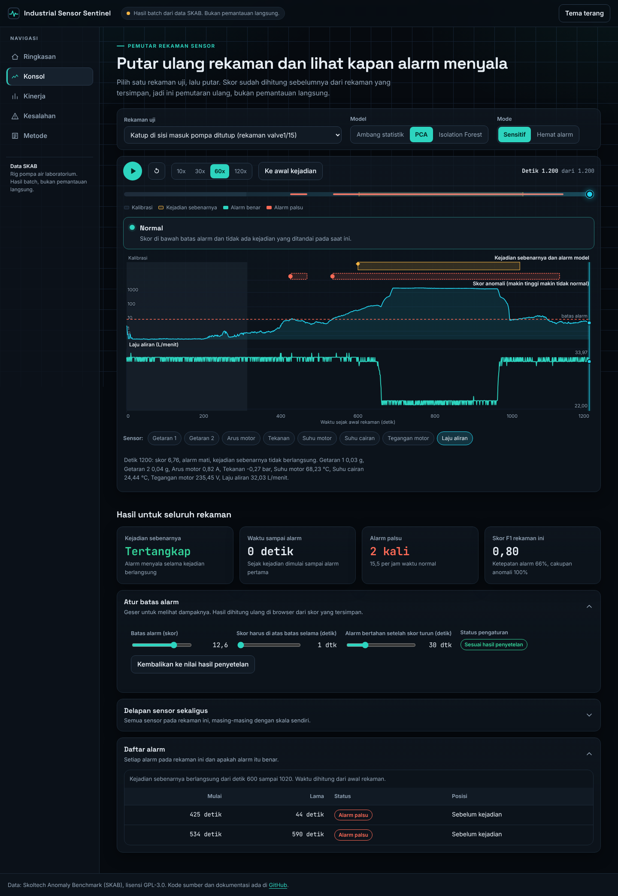
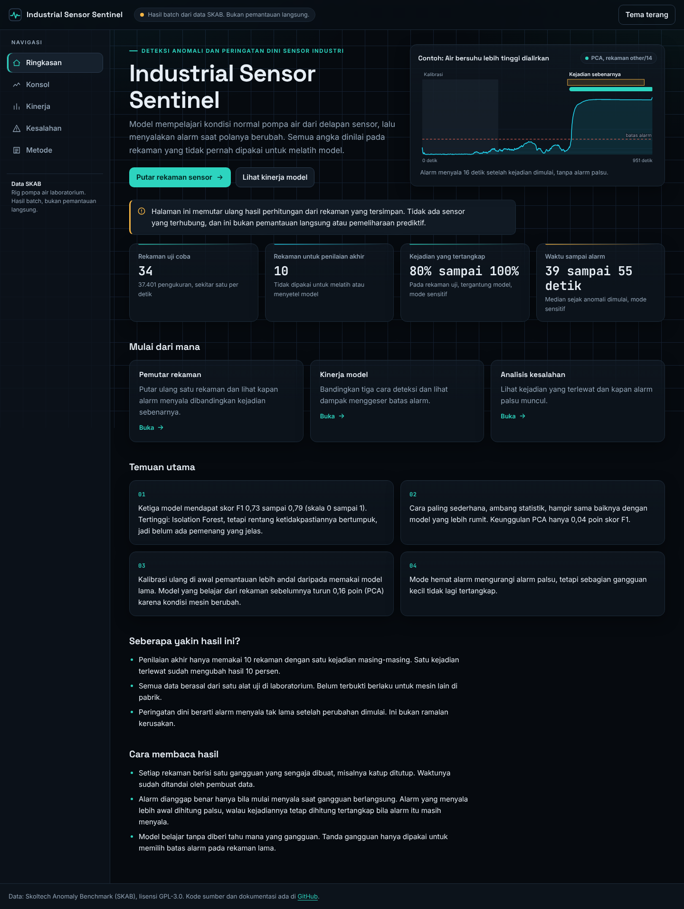
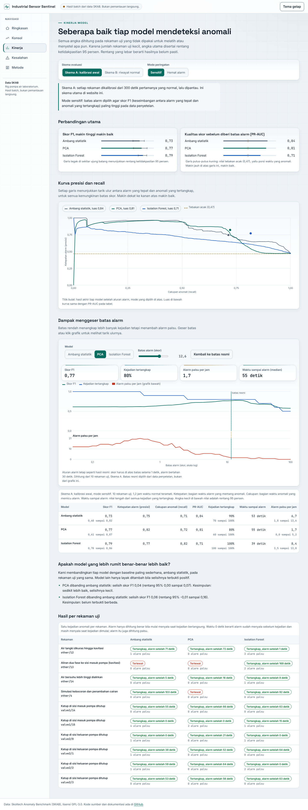
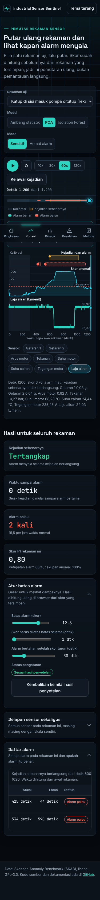

# Industrial Sensor Sentinel

Deteksi anomali dan peringatan dini sensor industri. Proyek ini melatih dan menilai tiga detektor tanpa label pada data **Skoltech Anomaly Benchmark (SKAB)**: 8 sensor pada rig pompa air, tercatat tiap detik. Hasilnya ditampilkan di website statis berbentuk konsol pemantauan.

**Demo:** https://industrial-sensor-sentinel.pages.dev/ (Cloudflare Pages, situs statis)

> Status: kode, evaluasi, website, dan CI selesai. Website sudah di-deploy ke Cloudflare Pages oleh pemilik repo. Website menampilkan **hasil batch** dari rekaman tersimpan: bukan pemantauan waktu nyata dan bukan pemeliharaan prediktif. Reproduksi di Kaggle belum dijalankan (lihat bagian Status).



| Ringkasan (desktop) | Kinerja (tema terang) | Konsol (ponsel) |
|---|---|---|
|  |  |  |

## Yang dikerjakan

- Pengambilan data SKAB pada commit yang dikunci, dengan checksum SHA-256 per berkas.
- Profil data: struktur, label, celah waktu, rezim operasi, dan tumpang tindih cap waktu.
- Pembagian per rekaman dan berurutan menurut waktu dalam tiap sesi, dengan rekaman pemisah. Tidak ada random split per baris.
- Tiga model tanpa label: ambang statistik (baseline), PCA (T2 dan Q), Isolation Forest.
- Dua skema evaluasi, dua mode peringatan, selang kepercayaan 95 persen dengan sampel ulang rekaman, dan perbandingan berpasangan terhadap baseline.
- Metrik tingkat titik dan tingkat kejadian: presisi, recall, F1, PR-AUC, recall kejadian, alarm palsu per jam, tunda deteksi.
- Analisis kesalahan per rekaman.
- Website statis (tanpa build, tanpa dependensi runtime) dengan alarm yang dihitung ulang di browser, diuji paritasnya dengan Python.
- Pengalaman interaktif: pemutar rekaman sensor (Putar, Jeda, Mulai ulang, kecepatan 10x sampai 120x, timeline dengan penanda kejadian dan alarm, tooltip), kurva presisi dan recall yang bisa ditelusuri, simulasi dampak menggeser batas alarm, dan garis waktu alarm benar, palsu, dan terlewat untuk semua rekaman uji. Semua visual dihitung dari skor tersimpan dan diuji agar sama dengan hasil Python (PR-AUC, F1, presisi, recall kejadian, alarm palsu per jam, tunda median).
- Animasi memakai CSS dan Web Animations API (transform dan opacity), menghormati `prefers-reduced-motion`, dan pemutaran selalu bisa dijeda.

## Hasil singkat (rekaman uji, skema A)

| Model | Mode | Skor F1 (selang 95%) | Presisi | Recall titik | PR-AUC | Kejadian terdeteksi | Tunda median | Alarm palsu per jam |
|---|---|---|---|---|---|---|---|---|
| Ambang statistik | sensitif | 0,73 (0,60 sampai 0,82) | 0,75 | 0,71 | 0,84 | 90% | 53 dtk | 6,7 |
| Ambang statistik | hemat alarm | 0,70 (0,55 sampai 0,81) | 0,78 | 0,63 | 0,84 | 80% | 69 dtk | 2,5 |
| PCA | sensitif | 0,77 (0,61 sampai 0,87) | 0,82 | 0,72 | 0,81 | 80% | 55 dtk | 1,7 |
| PCA | hemat alarm | 0,75 (0,56 sampai 0,87) | 0,86 | 0,66 | 0,81 | 80% | 58 dtk | 1,7 |
| Isolation Forest | sensitif | 0,79 (0,70 sampai 0,86) | 0,77 | 0,82 | 0,71 | 100% | 39 dtk | 8,4 |
| Isolation Forest | hemat alarm | 0,37 (0,10 sampai 0,62) | 0,91 | 0,23 | 0,71 | 40% | 106 dtk | 1,7 |

Alarm palsu per jam dihitung dari waktu normal teramati (1,2 jam pada 10 rekaman uji). Mode hemat alarm dipilih dengan batas 2 alarm palsu per jam pada data penyetelan, dan batas itu tidak dijamin pada data uji.

**Cara membaca:**

- Hanya 10 rekaman uji dengan 10 kejadian. Selang kepercayaan lebar dan urutan antar model belum pasti.
- Baseline ambang statistik yang sederhana hampir menyamai model lain. PCA unggul kecil atas baseline pada mode sensitif (selisih F1 0,04; selang 95% 0,00 sampai 0,07). Isolation Forest belum terbukti berbeda dari baseline. Karena itu tidak ditambahkan model lain.
- Pada skema B (model dilatih dari riwayat normal) hasilnya turun dan lebih tidak stabil karena kondisi mesin bergeser antar rekaman:

| Model | Mode | Skor F1 (selang 95%) | Presisi | Recall titik | PR-AUC | Kejadian terdeteksi | Tunda median | Alarm palsu per jam |
|---|---|---|---|---|---|---|---|---|
| Ambang statistik | sensitif | 0,57 (0,51 sampai 0,67) | 0,41 | 0,94 | 0,72 | 100% | 0 dtk | 4,8 |
| Ambang statistik | hemat alarm | 0,69 (0,48 sampai 0,84) | 0,84 | 0,58 | 0,72 | 80% | 61 dtk | 1,4 |
| PCA | sensitif | 0,61 (0,50 sampai 0,73) | 0,49 | 0,81 | 0,64 | 90% | 0 dtk | 15,7 |
| PCA | hemat alarm | 0,63 (0,54 sampai 0,74) | 0,48 | 0,91 | 0,73 | 100% | 0 dtk | 7,6 |
| Isolation Forest | sensitif | 0,53 (0,41 sampai 0,67) | 0,51 | 0,57 | 0,45 | 80% | 62 dtk | 2,4 |
| Isolation Forest | hemat alarm | 0,23 (0,00 sampai 0,40) | 0,39 | 0,16 | 0,45 | 30% | 28 dtk | 2,4 |

- Angka ini tidak dapat dibandingkan langsung dengan papan peringkat SKAB, karena protokol pembagian dan definisi alarm berbeda.

## Struktur repo

```
src/sentinel/      pipeline Python (data, split, fitur, model, metrik, evaluasi, ekspor)
tests/             tes pytest (sintetis dan data asli)
reports/           hasil evaluasi, profil data, analisis kesalahan (JSON)
web/public/        website statis untuk Cloudflare Pages
web/tests/         tes logika (node), e2e, aksesibilitas
notebooks/         notebook Kaggle untuk reproduksi
docs/              Data Card, Model Card, reproduksi, deploy
```

## Menjalankan

```bash
make install
make data                     # unduh dan verifikasi data SKAB
make check                    # lint + tes
.venv/bin/sentinel evaluate --web-out web/public/data   # seluruh eksperimen, sekitar 3 menit pada CPU
cd web && npm ci && npm test && npm run build
```

Detail ada di [docs/REPRODUCE.md](docs/REPRODUCE.md). Data dan model dijelaskan di [Data Card](docs/DATA_CARD.md) dan [Model Card](docs/MODEL_CARD.md).

## Kualitas

- Python: pytest (tes sintetis, tes data asli, tes reproduksi hasil), ruff, CI di Python 3.11 dan 3.13, pip-audit.
- Website: tes paritas alarm browser terhadap hasil Python untuk 60 konfigurasi, tes paritas kurva presisi-recall dan sapuan batas alarm terhadap `reports/results.json`, tes sinkronisasi status pemutar dengan episode alarm pada lebih dari 40 ribu titik, tes Putar, Jeda, Mulai ulang, dan laju bingkai saat memutar, tes e2e Playwright di 320, 375, 768, dan 1440 piksel (tema gelap dan terang, juga dengan CPU diperlambat 4 kali), pemeriksaan aksesibilitas axe (WCAG 2 AA), CSP ketat, tanpa permintaan pihak ketiga, npm audit.
- Pemeriksaan independen: `python tools/verify_published.py` menghitung ulang semua angka website dari CSV SKAB mentah tanpa memakai modul metrik proyek, lalu memeriksa pembagian data (uji selalu rekaman terbaru per sesi, kalibrasi tanpa label anomali). Dijalankan di CI.

## Status dan batasan yang jujur

- Hasil dihitung di sesi pengembangan (CPU). Notebook Kaggle ada di `notebooks/kaggle_train.ipynb`, tetapi **belum dijalankan di Kaggle** karena Kaggle tidak dapat dijangkau dari sesi ini. Notebook membandingkan hasilnya dengan `reports/results.json`.
- Website menampilkan **hasil batch**, bukan inferensi langsung. Yang dihitung ulang di browser hanya aturan alarm (ambang, ketekunan, penahanan) dari skor tersimpan.
- Website di-deploy ke Cloudflare Pages oleh pemilik repo di https://industrial-sensor-sentinel.pages.dev/. Sesi pengembangan tidak dapat membuka domain pages.dev, jadi pemeriksaan visual dan e2e dilakukan pada salinan lokal folder `web/public` yang sama. Panduan dan cara memperbaiki status integrasi Git ada di [docs/DEPLOY_CLOUDFLARE.md](docs/DEPLOY_CLOUDFLARE.md).
- Hasil uji sempat dilihat selama pengembangan. Setelah itu definisi alarm diperketat (alarm yang sudah menyala sebelum kejadian dihitung palsu) dan rentang ambang diperluas. Tidak ada parameter yang dipilih memakai rekaman uji. Rinciannya di [Model Card](docs/MODEL_CARD.md).
- Lihat bagian Keterbatasan di [Model Card](docs/MODEL_CARD.md).

## Lisensi

GPL-3.0, mengikuti lisensi data SKAB yang ikut diolah dan ditampilkan.
